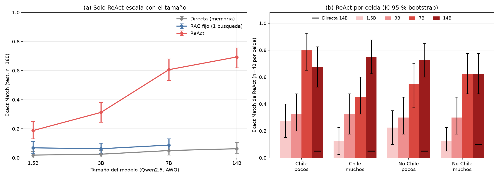

# ¿Buscar o recordar? ReAct sobre conocimiento chileno

Proyecto final de **CC5219 – IA Multimodal** (Universidad de Chile, 2026).

¿Cuándo le sirve a un modelo de lenguaje buscar en Wikipedia en vez de responder de memoria? Este proyecto aplica **ReAct** (Yao et al., 2022) a un **dataset nuevo de preguntas multi-hop en español sobre Chile**, con modelos abiertos chicos que corren en una GPU T4 de Colab.



## Pregunta de investigación

¿La ventaja de ReAct sobre responder de memoria crece cuando el conocimiento es **local** (Chile), cuando es **poco conocido**, o cuando el **modelo es pequeño**?

Sobre el tamaño hay dos predicciones opuestas:

- **Conocimiento** (Mallen et al., 2023; Kandpal et al., 2023): el modelo chico sabe menos, así que debería ganar más al buscar.
- **Capacidad** (Figura 3 del paper de ReAct): usar la herramienta exige planificar y seguir un formato, así que el modelo chico debería ganar menos.

## Resultados principales (test, 160 preguntas)

Exact Match (EM) con intervalo de confianza del 95 % por bootstrap:

| Modelo | Directa | RAG fijo | ReAct | Ganancia ReAct − Directa |
|---|---|---|---|---|
| Qwen2.5 1,5B | 0,02 | 0,07 | **0,19** | +0,17 [0,11–0,24] |
| Qwen2.5 3B | 0,03 | 0,06 | **0,31** | +0,29 [0,22–0,36] |
| Qwen2.5 7B | 0,05 | 0,09 | **0,61** | +0,56 [0,47–0,63] |
| Qwen2.5 14B (extra) | 0,06 | — | **0,69** | +0,63 [0,54–0,70] |

1. **La memoria no alcanza.** Sin buscar, ningún modelo pasa del 10 % de acierto, ni siquiera el 14B.
2. **Gana la predicción de capacidad.** La ganancia de ReAct crece con el tamaño y los intervalos del 1,5B y del 7B no se tocan. Con el 14B la curva se aplana. Es consistente con la Figura 3 de ReAct.
3. **No se detecta un efecto local.** Chile gana +4, +5, +6 y +6 puntos sobre el control en los cuatro modelos, siempre en la misma dirección, pero con intervalos superpuestos.
4. **La popularidad está confundida con el tipo de pregunta.** Los temas poco conocidos tienen más preguntas fáciles de "ciudad natal". La brecha que muestra el 7B desaparece con el 14B.
5. **El cuello de botella es la interfaz con la herramienta.** `Buscar` exige el título exacto y falla en el 42–65 % de las búsquedas. Cuando falla, sugiere 5 títulos parecidos, pero los modelos casi nunca los usan. El 1,5B se pierde en bucles; el 7B suele saber cuál es el artículo que necesita, pero no logra abrirlo.
6. **Hay alucinaciones.** A diferencia del paper (0 % entre los fallos, con PaLM-540B), aquí entre el 11 % y el 35 % de los fallos son respuestas que no aparecen en nada de lo que el modelo leyó, casi siempre tras una búsqueda fallida.

El informe completo, con el análisis de 7 errores concretos, está en [`notebook.ipynb`](notebook.ipynb).

## Dataset

No existía un dataset que cruzara origen con popularidad, con preguntas multi-hop en español. PopQA mide popularidad con preguntas de un salto y HotpotQA es multi-hop, pero ambos están en inglés. Por eso se construyó uno nuevo.

- **Fuente y licencia:** Wikipedia en español, CC BY-SA 4.0 (la misma licencia aplica al dataset).
- **Preguntas puente**, como en HotpotQA: se parte de un artículo A y de un artículo B enlazado en la introducción de A. La pregunta describe a B con un dato de A, sin nombrarlo, y la respuesta sale de B.
  > *¿En qué ciudad nació el compositor de la música del himno nacional de Chile?* → A: Himno nacional de Chile → B: Ramón Carnicer → **Tárrega**
- **Diseño 2×2:** origen de A (Chile o 8 países de control) × popularidad de A (número de Wikipedias en otros idiomas: ≤ 10 o ≥ 21). El control se empareja con Chile por tramos de popularidad.
- **Construcción:** pares A → B (`pairs.py`) → generación con Claude por lotes → filtros automáticos (400 → 305) → verificación adversarial en una sesión nueva (305 → 230) → split por celda con semilla fija, antes de cualquier experimento.
- **Tamaño:** 230 preguntas: 20 de dev, 160 de test (40 por celda) y 50 de reserva sin usar.
- **Calidad:** una auditoría manual de 20 preguntas estima entre 5 y 10 % de preguntas malas.

El dataset final está en [`data/dataset.jsonl`](data/dataset.jsonl). Cada pregunta incluye su respuesta, sus alias, los títulos de A y B, y las frases de evidencia de cada artículo.

## Método

- **Modelos:** Qwen2.5-Instruct 1,5B, 3B y 7B, todos cuantizados en AWQ de 4 bits para que la cuantización no contamine la comparación de tamaños. El 14B es un extra con otra configuración: contexto de 6144 tokens y sin RAG.
- **Inferencia:** vLLM en una GPU T4, decodificación greedy (`temperature=0`), contexto de 8192 tokens.
- **Condiciones** (mismos 2 ejemplos few-shot en las tres):
  - **Directa:** responde de memoria. Es el baseline.
  - **RAG fijo:** una búsqueda en Wikipedia con la pregunta y 3 resultados.
  - **ReAct:** hasta 7 pasos de pensamiento, acción y observación, con `Buscar[título]` (devuelve la introducción del artículo o 5 títulos similares si no existe) y `Terminar[respuesta]`.
- **Métricas:** Exact Match (principal) y F1, normalizadas y con alias. Intervalos de confianza por bootstrap con 1000 remuestreos, pareado para la ganancia.
- **Errores de ReAct:** se clasifican automáticamente según lo que el modelo leyó: bucle, no llegó a A, no llegó a B o leyó mal.

## Estructura del repositorio

```
├── notebook.ipynb        Informe (pregunta, dataset, resultados, errores, conclusiones)
├── experimento.ipynb     Experimento completo en Colab (GPU T4)
├── wiki.py               API de Wikipedia en español, con caché en disco
├── pairs.py              Selección de artículos y pares A → B (diseño 2×2)
├── questions.py          Lotes para el LLM, filtros, verificación y split
├── llm.py                Carga de modelos con vLLM e inferencia en lote
├── agents.py             Las tres condiciones: directa, rag y react
├── correr.py             Corre un modelo sobre un split y guarda las trazas
├── evaluate.py           Métricas, bootstrap, clasificación de errores y tablas
├── DECISIONES.md         Registro de decisiones de diseño y sus razones
├── data/
│   ├── dataset.jsonl     Dataset final (dev, test y reserva)
│   ├── pairs.jsonl       Pares A → B
│   ├── lotes_gen/, generadas/, lotes_verif/, verificadas/   Prompts y salidas del LLM
│   └── auditoria.md      Auditoría manual
├── resultados/
│   ├── trazas_*.jsonl    Trazas completas de cada modelo y condición
│   ├── tabla_test.csv, ganancia_test.csv, errores_test.csv
│   ├── figura_principal.png
│   └── analisis_errores.md
└── cache/wiki/           Respuestas de la API de Wikipedia (reproducibilidad sin red)
```

## Cómo reproducir

**Sin GPU (tablas desde las trazas guardadas):**

```bash
pip install pandas matplotlib requests
python evaluate.py test
```

Recalcula `tabla_test.csv`, `ganancia_test.csv`, `errores_test.csv` y `em_test.png` a partir de las trazas de `resultados/` y de la caché de Wikipedia, así que no necesita GPU ni red. La figura principal se genera en la sección 5 de `experimento.ipynb`.

**Experimento completo (Colab con GPU T4):** abrir [`experimento.ipynb`](experimento.ipynb). Instala vLLM, corre la prueba de formato, dev y test, y regenera tablas y figura. Cada modelo corre en un proceso aparte, porque vLLM no libera bien la GPU dentro de un notebook:

```bash
python correr.py 7B test        # un modelo, las tres condiciones
python correr.py 1.5B dev react # un modelo, una condición
python evaluate.py test
```

Los tres modelos principales tardan menos de una hora en total, y el 14B unos 30 minutos.

**Versiones probadas:** Python 3.13, vllm 0.34.0 (con torch 2.14.0+cu130). La decodificación usa `seed=0`, y el split y el bootstrap también usan semillas fijas.

**Reconstruir el dataset:**

```bash
python pairs.py                    # pares A → B
python questions.py lotes          # escribe los lotes para el LLM
# (un LLM procesa data/lotes_gen/ y deja sus salidas en data/generadas/)
python questions.py filtrar
python questions.py lotes_verif    # lotes para la verificación en una sesión nueva
# (un LLM procesa data/lotes_verif/ y deja sus salidas en data/verificadas/)
python questions.py split
python questions.py auditoria
```

`questions.py` no llama a ningún LLM: escribe los lotes y lee las salidas, para que todos los prompts y respuestas queden guardados.

## Limitaciones

- Con 40 preguntas por celda, los intervalos son de unos ±15 puntos: no hay potencia para detectar el efecto local ni la interacción entre origen y popularidad.
- El dataset lo generó y verificó un LLM; se estima entre 5 y 10 % de preguntas malas.
- El tipo de pregunta está ligado a la popularidad, y el control de "pocos" es mayoritariamente peruano.
- Solo se probó una familia de modelos (Qwen2.5 cuantizado), con un prompt fijo y sin comparar con CoT ni Act. La búsqueda exige el título exacto y el EM es estricto.

## Uso de IA

El código se escribió con Claude Code a partir de especificaciones propias; el diseño, la revisión y las pruebas son del autor. Claude generó las preguntas del dataset y otras sesiones de Claude las verificaron.

## Referencias

- Yao et al. (2022). *ReAct: Synergizing Reasoning and Acting in Language Models*.
- Mallen et al. (2023). *When Not to Trust Language Models: Investigating Effectiveness of Parametric and Non-Parametric Memories* (PopQA).
- Kandpal et al. (2023). *Large Language Models Struggle to Learn Long-Tail Knowledge*.
- Yang et al. (2018). *HotpotQA: A Dataset for Diverse, Explainable Multi-hop Question Answering*.

## Autor

Felipe Cárdenas — CC5219 IA Multimodal, Universidad de Chile.
